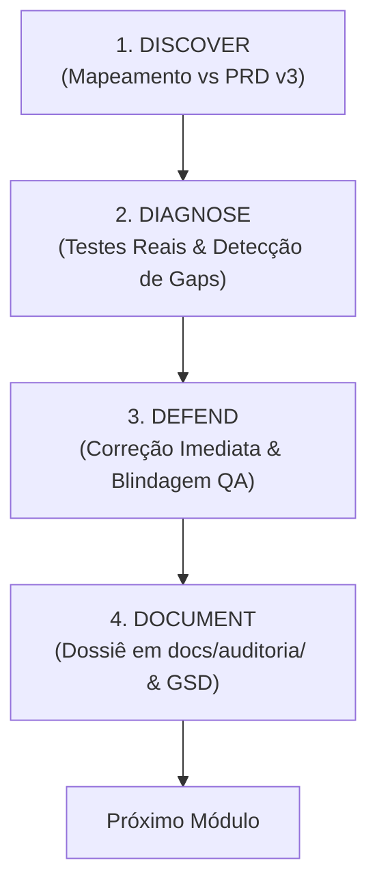

# Especificação de Design: Varredura, Auditoria de Paridade e Blindagem QA do ArchFlow ERP

- **Status**: Em Revisão
- **Data**: 06 de Outubro de 2026
- **Autores**: Italo520 & Antigravity
- **Escopo**: Auditoria Vertical de Ponta a Ponta, Testes Formais (JUnit 5 + Vitest), Resolução de Gaps e Governança GSD
- **Documento de Referência**: `docs/PRD_COMPLETO_v3.md` (adaptado da stack legada para a nova arquitetura)

---

## 1. Contexto e Objetivo

O **ArchFlow ERP** passou recentemente por uma grande migração arquitetural: saiu do monólito legado em Next.js 14 / Prisma / Server Actions para uma arquitetura moderna e desacoplada:
- **Backend**: Java 21 LTS, Spring Boot 3.4.x, Spring Data JPA, Spring Security com JWT Stateless, Flyway Migrations, MapStruct, Lombok, RFC 7807 (Problem Details).
- **Frontend**: React 19, TypeScript, Vite, TanStack Router, TanStack Query, Tailwind CSS, Radix UI.

### O Desafio
O [PRD_COMPLETO_v3.md](file:///c:/Users/italo/Desktop/Projects/erp_archflow_arquiteture/docs/PRD_COMPLETO_v3.md) foi originalmente escrito com premissas do framework legado (Next.js/Prisma). É imperativo:
1. **Mapear a paridade funcional real**, identificando o que já foi portado com sucesso, o que está mockado ou incompleto, e o que quebrou na transição.
2. **Aplicar engenharia de testes rigorosa** para evitar regressões, blindando cada camada contra falhas.
3. **Persistir o progresso em loop** (via GSD / `.planning/` e `docs/auditoria/`), garantindo resiliência contra quebras de contexto em sessões longas.
4. **Alcançar o estado de "Zero Bugs Conhecidos" e 100% operacional**.

---

## 2. Matriz de De-Para: PRD Legado vs Nova Stack

Todas as referências do PRD v3 devem ser interpretadas pela seguinte matriz de tradução técnica:

| Conceito no PRD Legado (Next.js) | Implementação na Nova Stack (ArchFlow Moderno) | Critério de Aceite e Validação |
| :--- | :--- | :--- |
| **Server Actions** (`app/actions/*.ts`) | **Spring REST Controllers** (`@RestController`, `@RequestMapping("/api/v1/...")`) | Contratos REST JSON padronizados, DTOs de Request/Response com validação Bean Validation (`@Valid`). |
| **Schema Prisma** (`prisma/schema.prisma`) | **Entidades JPA + Migrations Flyway** (`backend/.../entity`, `db/migration/V*.sql`) | Tabelas versionadas no Flyway, chaves estrangeiras íntegras, mapeamento de enums e tipos complexos. |
| **NextAuth.js v5** (`auth.ts`, sessões) | **Spring Security + JWT** (`modules/auth`, `JwtTokenProvider`, Bearer token) | Autenticação stateless, claims de usuário/papéis (`ADMIN`, `ARCHITECT`, `CLIENT`), expiração e refresh. |
| **Zod Validations** (`lib/validations.ts`) | **Jakarta Bean Validation** (Back) + **Form Validation** (Front) | Anotações `@NotBlank`, `@Size`, `@Pattern` (CPF/CNPJ) no Java e validações de input em componentes React. |
| **Páginas e Server Components** | **SPA React 19** com **TanStack Router & Query** | Roteamento baseado em tipos, caching assíncrono via React Query, tratamento de estados `loading`, `error` e `success`. |
| **Toast Notifications (Sonner)** | **Componentes de Notificação / Toasts React** | Feedback visual imediato para mutações (sucesso, validação e erro amigável RFC 7807). |

---

## 3. Metodologia de Varredura: O Ciclo 4D por Fatia Vertical

A varredura e saneamento do sistema ocorrerão em **fatias verticais** (módulo por módulo, cobrindo Banco -> API -> Frontend). Cada módulo percorre o ciclo 4D:



### 3.1. Fase 1: Discover (Inventário de Paridade & Especificação de Casos de Uso)
- **Documentação de Casos de Uso e User Stories**: Antes de iniciar os testes ou diagnósticos do módulo, estruturar formalmente as Histórias de Usuário (User Stories) e Casos de Uso derivados do [PRD_COMPLETO_v3.md](file:///c:/Users/italo/Desktop/Projects/erp_archflow_arquiteture/docs/PRD_COMPLETO_v3.md), definindo para cada uma os **Critérios de Aceitação (Acceptance Criteria / Given-When-Then)**. É essa especificação que fundamenta os critérios de sucesso e o Definition of Done (DoD).
- Leitura detalhada dos requisitos do módulo no PRD v3 (adaptados para a nova stack).
- Inventário de artefatos existentes:
  - Backend: Controllers, Services, Repositories, Entities, DTOs, Mappers e Migrations Flyway.
  - Frontend: Views (`frontend/src/views`), Componentes (`src/components`), Serviços de API (`src/services/api.ts`) e Rotas.
- Geração da tabela de paridade do módulo (Status: *Implementado*, *Incompleto*, *Mock*, *Ausente*).

### 3.2. Fase 2: Diagnose (Auditoria Funcional & Detecção de Gaps)
- Testes de ponta a ponta dos fluxos do módulo (chamadas reais HTTP, persistência, navegação e interações de tela).
- Catalogação de falhas:
  - Erros 4xx/500 em endpoints.
  - Queries com problema de N+1 ou falta de índices em chaves de busca.
  - Falhas de concorrência ou campos desserializados incorretamente.
  - Inconsistências de layout ou dados estáticos mascarados como dinâmicos.

### 3.3. Fase 3: Defend (Correção Imediata & Blindagem de Regressão)
- **Correção em tempo real**: Qualquer bug funcional detectado no código de produção do módulo é corrigido imediatamente.
- **Implementação da Matriz de Testes Formais** (detalhada na Seção 4):
  - Testes Unitários de Services com Mockito.
  - Testes de Contrato e Controller com `@WebMvcTest`.
  - Testes de Componentes e Serviços Frontend com Vitest e Happy-DOM.
- **Métrica de Corte**: Cobertura de branches >= 85% no JaCoCo e 100% de testes verdes.

### 3.4. Fase 4: Document (Governança GSD e Documentação Viva)
- Criação/atualização do dossiê `docs/auditoria/0X-<modulo>.md`.
- Atualização em loop do [STATE.md](file:///c:/Users/italo/Desktop/Projects/erp_archflow_arquiteture/.planning/STATE.md) e [CONTEXT.md](file:///c:/Users/italo/Desktop/Projects/erp_archflow_arquiteture/docs/CONTEXT.md).

---

## 4. Matriz Formal de Técnicas de Teste de Software

Para assegurar a eliminação matemática de falhas e evitar qualquer regressão, os testes de cada módulo deverão aplicar as técnicas adequadas conforme a tabela abaixo:

| Técnica de Teste | Camada Alvo | Quando e Onde Aplicar no ArchFlow | Exemplos de Cenários |
| :--- | :--- | :--- | :--- |
| **Particionamento por Classes de Equivalência (CE)** | Backend DTOs & Frontend Forms | Validações de entradas em cadastros de clientes, projetos e atividades | - CPF/CNPJ válidos vs com dígitos incorretos vs mascaramento inválido.<br>- E-mail válido vs formato malformado.<br>- Perfis de usuário autorizados (`ADMIN`, `ARCHITECT`) vs proibidos (`CLIENT`). |
| **Análise de Valor Limite (AVL)** | Regras de Negócio & Cálculos | Orçamentos, prazos de entrega, limites de arquivos e paginação | - Orçamento: `0.00`, `-0.01` (rejeitado), valor máximo permitido.<br>- Prazos: data de entrega igual à data de início, data passada.<br>- Paginação: `page=0`, `size=1`, `size=100`, `size=101` (overflow). |
| **Tabela / Matriz de Transição de Estados** | Entidades com Ciclo de Vida | Fluxos de Vistorias, Fases de Projeto e Kanban | - **Vistoria**: `DRAFT -> COMPLETED -> SENT`. (Proibir retorno de `SENT` para `DRAFT` sem permissão).<br>- **Punch List**: `PENDING -> IN_PROGRESS -> RESOLVED -> CANCELLED`.<br>- **Tarefas Kanban**: `A_FAZER -> EM_ANDAMENTO -> REVISAO -> CONCLUIDO`. |
| **Tabelas de Decisão / Fluxogramas** | Serviços de Orquestração | Ações complexas com múltiplas condições simultâneas | - Duplicação de projeto (clonar fases? clonar equipe? manter orçamento original?).<br>- Cálculo de rentabilidade (horas orçadas vs registradas vs custo/hora do arquiteto). |
| **Suposição de Falhas (Error Guessing)** | Services, Controllers e Clientes HTTP | Tratamento de exceções e resiliência | - Envio de UUIDs inexistentes (`EntityNotFoundException` com retorno 404 padronizado).<br>- Payload com campos obrigatórios omitidos (`MethodArgumentNotValidException`).<br>- Conflito de dados (`DataIntegrityViolationException` / Unique constraints). |
| **Cobertura Estrutural de Branches (JaCoCo / Vitest)** | Pipelines de Build | Medição automática em `mvn test` e `npm test` | - Todo `if`, `else`, `switch` e bloco `catch` deve ser exercitado.<br>- Meta: **>= 85% de branches cobertas**. |
| **Testes Exploratórios & Usabilidade** | Frontend SPA | Validação da experiência operacional do arquiteto | - Fluxo de upload de fotos de vistoria em canteiro.<br>- Arrastar e soltar cards no Kanban em telas menores.<br>- Estados visuais de loading (*skeletons*) e tratamento de rede offline. |

---

## 5. Governança em Loop com GSD (Persistência entre Sessões)

Para impedir perda de progresso durante sessões longas ou interrupções de contexto:

1. **Estado Centralizado no GSD** ([.planning/STATE.md](file:///c:/Users/italo/Desktop/Projects/erp_archflow_arquiteture/.planning/STATE.md)):
   - O `STATE.md` será atualizado após a conclusão de cada módulo ou etapa crítica, indicando explicitamente o status atual e o próximo passo imediato.
2. **Dossiês Modulares em `docs/auditoria/`**:
   - Cada módulo auditado gerará seu relatório persistido:
     - `docs/auditoria/01-auth-rbac.md`
     - `docs/auditoria/02-clientes-crm.md`
     - `docs/auditoria/03-projetos-kanban.md`
     - `docs/auditoria/04-atividades-time-tracking.md`
     - `docs/auditoria/05-vistorias-punch-list.md`
     - `docs/auditoria/06-documentos-storage.md`
     - `docs/auditoria/07-dashboards-relatorios.md`
     - `docs/auditoria/08-notificacoes-configuracoes.md`
3. **Padrão do Dossiê do Módulo**:
   - **Casos de Uso & Histórias de Usuário**: Especificação formal de atores, fluxos principais, fluxos alternativos e User Stories com critérios de aceitação Given-When-Then.
   - **Inventário vs PRD v3**: Status de cada requisito planejado adaptado para a nova stack.
   - **Matriz de Testes & Técnicas de QA**: Lista dos testes cobrindo cada critério de aceite (Classes de Equivalência, Valor Limite, Transição de Estados, Tabela de Decisão, Error Guessing).
   - **Gaps & Bugs Corrigidos**: Histórico de problemas sanados no código de produção.
   - **Débito Técnico & Otimizações**: Oportunidades de melhoria arquitetural (consultas, índices, refatorações).
   - **Definition of Done (DoD)**: Checklist de conformidade e cobertura.

---

## 6. Sequência de Execução dos Módulos

Seguindo a dependência lógica do ERP:

```
[Módulo 01: Auth & RBAC]
          │
          ▼
[Módulo 02: Clientes & CRM]
          │
          ▼
[Módulo 03: Projetos, Etapas & Kanban]
          │
          ├──────────────────────────┐
          ▼                          ▼
[Módulo 04: Atividades/Horas]  [Módulo 05: Vistorias & Punch List]
          │                          │
          └───────────┬──────────────┘
                      ▼
[Módulo 06: Armazenamento & Documentos]
                      │
                      ▼
[Módulo 07: Dashboards & Relatórios Financeiros]
                      │
                      ▼
[Módulo 08: Notificações & Configurações]
```

---

## 7. Critérios de Sucesso e Definition of Done (DoD)

Para declarar que um módulo e o sistema como um todo estão **100% funcionais e livres de bugs**:

1. **Rastreabilidade de Casos de Uso & User Stories**:
   - 100% dos Casos de Uso e User Stories levantados possuem critérios de aceitação validados por testes automatizados (zero premissas sem teste correspondente).
2. **Verificação Automatizada**:
   - `mvn -f backend/pom.xml test` executa com **zero falhas** e gera relatório JaCoCo com cobertura de branches >= 85%.
   - `npm run test --prefix frontend` executa com **zero falhas** no Vitest.
   - `npm run build --prefix frontend` compila com TypeScript estrito sem erros.
3. **Conformidade Funcional**:
   - Todas as ações previstas no PRD v3 para o módulo estão ativas e integradas de ponta a ponta (Back + Front).
   - Nenhum endpoint retorna 500 sem tratamento estruturado (ProblemDetail RFC 7807).
4. **Governança & Rastreabilidade**:
   - Dossiê do módulo registrado em `docs/auditoria/0X-<modulo>.md`.
   - `.planning/STATE.md` atualizado com o progresso exato.
